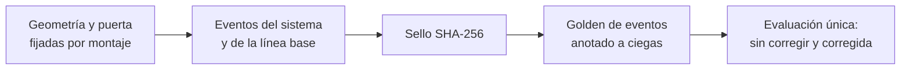

# Bloque C del artículo — Método de la prueba multicámara (borrador, 2026-10-18)

Borrador de la Tesis 15 con la parte que **no depende de resultados**: datos, geometría por
montaje, detección de la puerta, verdad de terreno y protocolo de evaluación. Los huecos
`«PENDIENTE …»` se llenan con `docs/resultados-<video>.md` (evaluar_prueba.sh) y con la 17b.
Las cifras citadas salen de `docs/inventario-camaras.md`, `docs/criba-door-open.md`,
`docs/curvas-puerta-medidas.md` y `docs/comparacion-trackers.md`.

---

## C.1 Datos y estratificación

El corpus son 480 videos de bus de cámaras cenitales con lente ojo de pez (640×480, 30 fps),
en cuatro posiciones de cámara (nombres del conjunto de datos): DDL (*DoubleDoorCameraLeft*),
DDR (*DoubleDoorCameraRight*), SDM (*SingleDoorMiddle*) y SDR (*SingleDoorRear*), cada una en
varias secuencias de grabación, que se agrupan por **montaje**. Un montaje es una combinación cámara–secuencia: misma posición física, mismo
encuadre y misma puerta.

Cada video se describió de forma automática a un fotograma por segundo con el detector de
cabezas final (§B) para estratificarlo antes de elegir nada:

- **Iluminación** por la luminancia mediana: noche < 20 ≤ penumbra < 60 ≤ día. La
  distribución es bimodal (157 videos por debajo de 10).
- **Congestión** por el porcentaje de segundos con ocho o más cabezas visibles, con los
  umbrales anclados en videos ya anotados: baja < 10 % ≤ media < 25 % ≤ alta.
- **Estado**: si el video, o su secuencia, aportó imágenes al entrenamiento del detector.

| Cámara | Videos | Día | Diurnos nunca vistos (baja / media / alta) |
|---|---|---|---|
| DDL | 151 | 85 | 54 / 11 / 12 |
| DDR | 195 | 111 | 70 / 18 / 20 |
| SDM | 108 | 59 | 43 / 5 / 9 |
| SDR | 26 | 11 | 9 / 0 / 0 |

Los conteos de cabezas los hace el propio detector, que en SDM y SDR (encuadre distinto y más
desenfoque) cuenta de menos: el nivel de congestión no es del todo comparable entre cámaras.

**Partición.** Desarrollo, validación y la primera prueba son de un mismo montaje DDL:
videoTM_07 (desarrollo, congestión baja), videoTM_03 (validación, baja) y videoTM_02 (prueba,
alta). Para medir si el sistema y su corrección de sesgo se transfieren a otras cámaras se
añade **un video de prueba por cámara nueva**, nunca visto y diurno:

| Cámara | Video de prueba | Nivel (% lleno) | Uso previo |
|---|---|---|---|
| DDL | videoTM_02 | alta (34,9) | prueba (ya evaluada) |
| SDM | videoTM_03(1) = bus_sdm_s4_v03 | media (13,1) | prueba |
| DDR | bus_ddr_s6_v18 | alta (39,1) | prueba |
| SDR | bus_sdr_s1_v08 | baja (0,0) | prueba |

Ningún video de prueba se usó para ajustar nada: ni parámetros de la regla, ni factores de
corrección, ni el detector.

## C.2 Geometría por montaje

Cada montaje lleva tres elementos fijados **antes** de anotar su prueba y que valen para todos
sus videos:

1. **Región de interés (ROI):** polígono trazado a mano sobre un fotograma sin pasajeros de la
   misma secuencia (el más parecido a la mediana temporal). Deja fuera el andén, las ventanas y
   el exterior visible a través del vidrio. Las detecciones fuera de la ROI se descartan antes
   del seguimiento.
2. **Curvas de puerta:** dos polilíneas que siguen la puerta en la imagen deformada por el ojo
   de pez. La **exterior** separa el andén del umbral y la **interior** el umbral del pasillo; la
   regla de conteo (§C.4) se define respecto de la interior.
3. **Detector de puerta abierta** (§C.3), con su referencia de puerta cerrada.

**Medición de las curvas.** En lugar de colocarlas a ojo, las curvas se validan con las propias
detecciones (`medir_curvas.py`). Con la puerta cerrada, lejos (±150 fotogramas) de toda apertura,
todas las cabezas visibles son de pasajeros que van dentro. Unas curvas bien colocadas cumplen dos
condiciones: **ninguna cabeza pasa la exterior** y la **interior va pegada** a las cabezas de dentro
que más se acercan a la puerta (percentil 1 de la distancia firmada ≈ 0). Las detecciones fijas
que no se mueven en todo el video (un reflejo en el vidrio, una pegatina) se descuentan.

| Cámara | Cabezas con la puerta cerrada | Pasan la exterior | p1 a la interior (px) | Curvas |
|---|---|---|---|---|
| DDL (07 / 03 / 02) | 94.121 / 71.283 / 99.094 | 2 / 1 / 1 | −3,6 / −2,4 / +3,7 | a mano, sin cambios |
| SDM 03(1) | 13.584 | 13 | −12,9 | a mano, sin cambios |
| DDR s6 | 118.822 | 1 | +20,4 | medidas: +30 px |
| SDR s1 | 40.633 | 7 | +11,1 | medidas: +30 px |

En DDR y SDR la primera propuesta dejaba 35–50 px de holgura sobre el andén; se desplazó 30 px
hacia el pasillo. Las curvas quedan sobre el vidrio y no sobre el umbral del piso porque, con el
bus lleno, la cabeza de quien va apoyado en la puerta cae sobre el vidrio.

## C.3 Detección de la puerta abierta

Solo cuentan los cruces con la puerta abierta, así que el sistema necesita saber cuándo lo está.
`door.py` lo infiere de la imagen y no de una señal del bus:

1. Recorte fijo de la zona de las hojas, en gris y reducido a 36×52, una muestra cada 3 fotogramas.
2. Mapa de bordes (magnitud del gradiente), robusto a los cambios de luz.
3. **Referencia de puerta cerrada:** mediana de los mapas de bordes de un tramo con la puerta
   cerrada y sin gente. Se guarda **por montaje** y se transfiere entre videos de la misma
   secuencia: en DDR s6, la referencia de un video da en otro las mismas 11 aperturas que la propia.
4. Similitud por correlación cruzada normalizada con la referencia (cerrada 0,6–0,95; abierta
   0,05–0,2), mediana móvil de 10 muestras, umbral 0,35 y tramos de al menos 1,5 s. Un recorte
   casi negro (túnel) cuenta como cerrado.

Los parámetros son los del montaje DDL y no se reajustan por cámara: solo cambian el recorte y la
referencia.

**Elegibilidad del video.** El método falla cuando la puerta no se ve: gente apoyada en ella o un
bus detenido al lado, visible a través del vidrio. Por eso los videos de prueba se eligieron entre
aquellos en que la puerta es **legible**: el percentil 75 de la similitud por minuto es ≥ 0,6 en al
menos el 80 % de los minutos, ningún intervalo de puerta abierta dura más de 30 s y hay al menos
cuatro aperturas. De 30 videos diurnos de DDR s6 y SDR s1, 14 cumplen (8 y 6). Los dos videos que
el inventario proponía primero (DDR v15 y SDR v10, los más llenos) quedaron fuera: en ellos la
puerta se ve el 20 % y el 7 % de los minutos.

**Precisión del detector de puerta en la prueba.** Cada intervalo se revisó a ojo y se buscaron
aperturas perdidas en los tramos de similitud baja fuera de todo intervalo:

| Video | Intervalos | Reales | Falsos | Perdidas | Precisión | Recall |
|---|---|---|---|---|---|---|
| DDR s6_v18 | 11 | 11 | 0 | 0 | 1,00 | 1,00 |
| SDR s1_v08 | 12 | 11 | 1 | 0 | 0,92 | 1,00 |

El único falso (SDR) es un pasajero de pie contra la puerta cerrada con un bus rojo detrás del
vidrio. El recall es el de una búsqueda dirigida, no el de una revisión fotograma a fotograma.

## C.4 Sistema evaluado (congelado)

El sistema se congeló al cerrar la validación (12-10) y es el mismo en las cuatro cámaras:

- detector de cabezas yolo26x-min5 con NMS posterior a 0,6 (§B);
- descarte fuera de la ROI;
- ByteTrack (búfer 90, emparejamiento 0,9);
- **regla origen–destino:** con la puerta abierta, una subida es un track que nace a ≤ 40 px de la
  curva interior y llega a ≥ 80 px hacia el pasillo; una bajada, al revés;
- **corrección de sesgo:** conteo / factor, con el factor por dirección = Σcontado / Σreal en los
  videos 03 y 07 (subidas 0,68, IC95 0,47–0,94; bajadas 0,62, IC95 0,52–0,73) e intervalo por
  bootstrap de aperturas.

**Línea base sin seguimiento.** Mismas detecciones, ROI y puerta; empareja cada detección con la
más cercana del fotograma siguiente (≤ 40 px) y cuenta los pares que cruzan la curva interior. Así,
la única diferencia con el sistema es el seguimiento. Tiene su propio factor de corrección, ajustado
igual en 03+07: subidas 0,56 (IC95 0,34–1,08), bajadas 0,52 (0,40–0,73).

## C.5 Verdad de terreno

**Eventos.** Una persona (el autor) anota en CVAT un punto por persona y cruce, sobre la cabeza,
en el primer fotograma en que alcanza la curva interior: `sube`, `baja` o `raro` cuando hay duda de
si cuenta o en qué dirección (no cuenta y se lista aparte). El criterio, los casos difíciles y el
recorrido de cada tarea están en la guía de anotación (`docs/guia-anotacion.md`, Anexo X). Medido
en el 07, el criterio adelanta el evento 1–4 fotogramas respecto del cruce del centro de la cabeza,
de forma constante y por debajo de la tolerancia de emparejamiento.

En las cámaras nuevas el golden es **reducido**: cinco aperturas por video, elegidas a ojo entre
las que tienen subidas (con 60 fotogramas de margen a cada lado), en lugar del video completo.
Las aperturas se delimitan a ojo y **no salen de door.py**, para que la verdad no dependa del
componente evaluado. Las imágenes no llevan pre-anotación.

| Video | Aperturas | Imágenes | Subidas | Bajadas | Raros |
|---|---|---|---|---|---|
| SDM 03(1) | «PENDIENTE 19a» | | | | |
| DDR s6_v18 | 5 | 1.370 | «PENDIENTE 19b» | | |
| SDR s1_v08 | 5 | 1.215 | «PENDIENTE 19c» | | |

**Seguimiento.** Para comparar trackers (§D) hay un clip de 200 fotogramas por cámara nueva
(DDR s6_v18 desde el 12.261, SDR s1_v08 desde el 4.581), pre-anotado con ByteTrack y corregido a
mano (cajas e identidades). La pre-anotación favorece a ByteTrack; se declara como sesgo.

## C.6 Protocolo de evaluación

1. **Orden.** Geometría y puerta se fijan con el video de prueba sin anotar. Después se generan
   los eventos del sistema y de la línea base y se **sellan** con su SHA-256
   (`configs/prueba_sellada.sha256`). Solo entonces se anota el golden. La evaluación comprueba el
   sello y se detiene si algún fichero cambió.
2. **Una sola evaluación por video.** No se reajusta nada con su resultado.
3. **Métricas por apertura y en total**, separadas por dirección, como la Tabla I del
   anteproyecto: conteo real y contado, error absoluto y porcentual con signo, y, emparejando por
   dirección a ±10 fotogramas, recall (personas contadas) y precisión (eventos que son una persona
   real). Se dan las dos porque el error de conteo puede ser nulo con eventos mal colocados.
4. **Corrección:** el factor de 03+07 se aplica sin reestimar. La pregunta de la prueba
   multicámara es si el total real cae dentro del intervalo corregido en las cámaras que no
   aportaron al factor.
5. **Golden reducido:** solo se evalúan las aperturas anotadas. Los falsos de door.py fuera de ellas
   no se penalizan aquí; se reportan aparte (§C.3). Una apertura anotada sin cruces cuenta igual, y
   cualquier evento del sistema en ella es un falso positivo.

## C.7 Resultados (por llenar)

**Tabla I multicámara** — «PENDIENTE: evaluar_prueba.sh sobre 03(1), v18 y v08»

| Cámara | Video | Nivel | Real s/b | Sin corregir s/b | Corregido s/b | Recall s/b | Precisión s/b | Línea base corregida s/b |
|---|---|---|---|---|---|---|---|---|
| DDL | 02 | alta | 18 / 41 | −28 / −39 % | +7 / −1 % | | 0,85 / 0,92 | ≈ +99 / +26 % |
| SDM | 03(1) | media | | | | | | |
| DDR | s6_v18 | alta | | | | | | |
| SDR | s1_v08 | baja | | | | | | |

«PENDIENTE 22: ¿un factor global o uno por cámara?» · «PENDIENTE 17b: HOTA/IDF1 en los clips DDR y SDR».

## C.8 Limitaciones de la prueba multicámara

- **Un video por cámara nueva y cinco aperturas:** el intervalo del error es ancho; la prueba
  detecta un sesgo grande entre cámaras, no uno de pocos puntos.
- **Cámara y congestión confundidas:** cada cámara nueva aporta un solo nivel (SDM media, DDR alta,
  SDR baja). En SDR no hay ningún video diurno nunca visto lleno con la puerta visible.
- **Selección por legibilidad de la puerta:** los videos donde la puerta no se ve quedaron fuera
  por construcción; el error en ellos sería mayor, sobre todo por door.py.
- **Un solo anotador**, sin medida de acuerdo entre anotadores.
- **SDR s1 tiene videos en el entrenamiento** del detector (la secuencia, no el video de prueba).
- El nivel de congestión lo mide el mismo detector que se evalúa, que cuenta de menos en SDM y SDR.
