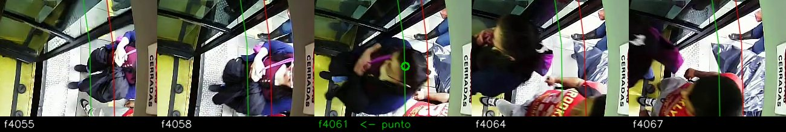
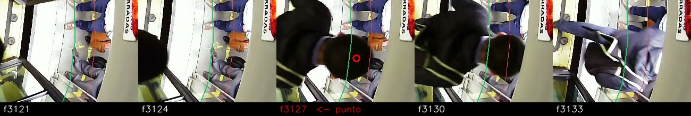
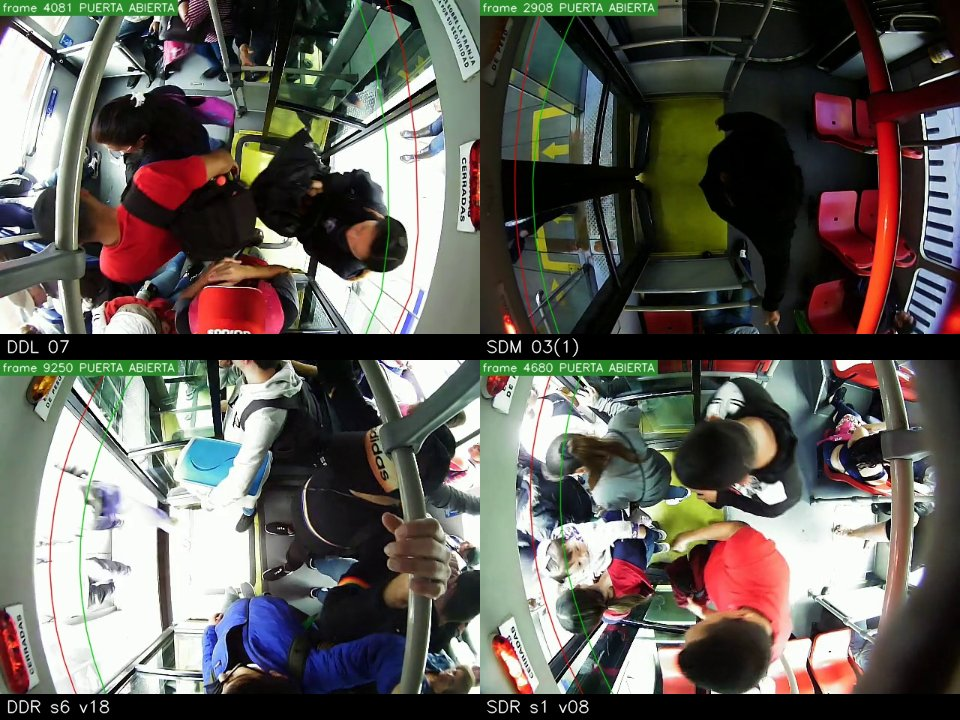

# Guía de anotación de eventos (subidas y bajadas) — Tesis 7, OE1

Escrita el 2026-10-18 a partir de los criterios fijados con los goldens de videoTM_07, 03 y 02
(12-10). Vale para los goldens reducidos de la prueba multicámara (19a SDM 03(1), 19b DDR v18,
19c SDR v08) y es el texto de partida del apartado de la memoria sobre la verdad de terreno.
Los casos 2 y 5 se fijaron al escribir la guía y Camilo los confirmó el 18-10.

## Qué es un evento

Una persona que **cruza la puerta** durante una apertura: `sube` si entra del andén al pasillo,
`baja` si sale del pasillo al andén. Se anota **un punto por persona y cruce**, sobre el centro de
la cabeza, en el **primer frame en que la cabeza alcanza la curva interior (verde)**.

- La curva **roja** (exterior) está del lado del andén; la **verde** (interior), del lado del
  pasillo. Son las mismas que usa el sistema (`configs/cameras/*.yaml`, `door.inner/outer`).
- Quien sube va de la roja hacia la verde y la alcanza al entrar; quien baja llega a la verde
  desde el pasillo, antes de salir. En ambos casos el frame es el de **alcanzar la verde**.
- Por qué la verde y "alcanzar": es un instante que se ve igual en las cuatro cámaras y que no
  depende de dónde acaba la persona. Medido en el 07: cae 1–4 frames antes de que el centro de la
  cabeza cruce la curva, de forma constante. La evaluación empareja a ±10 frames
  (`eval_flow.py --tol 10`), así que no hace falta afinar más de 2–3 frames.

## Las cuatro cámaras

| Cámara | Puerta | Subir es moverse… | Videos |
|---|---|---|---|
| DDL (07, 03, 02) | derecha | de derecha a izquierda | goldens completos (12-10) |
| SDM 03(1) | izquierda | de izquierda a derecha | 19a, tarea 11 de CVAT |
| DDR s6 | izquierda | de izquierda a derecha | 19b, v18 |
| SDR s1 | izquierda | de izquierda a derecha | 19c, v08 |

La imagen del fisheye está girada: "derecha/izquierda" se refiere a la imagen, no al bus. En
caso de duda, el andén es el lado de la curva roja.

## Etiquetas

| Etiqueta | Cuándo | ¿Cuenta? |
|---|---|---|
| `sube` | entra del andén al pasillo y alcanza la verde | sí |
| `baja` | sale del pasillo y alcanza la verde camino del andén | sí |
| `raro` | **duda** de si cuenta o en qué dirección; atributo `nota` obligatorio | no, se lista aparte |

`raro` es para dudas sobre la **persona**, no para defectos del video. Los **saltos de frames**
(p. ej. 5.396 → 5.397 con la escena movida) no se anotan: se miden aparte y pesan poco (Tesis 8).

## Casos difíciles

1. **Llega a la verde y se da la vuelta sin cruzar** (se asoma, deja pasar a otro): nada.
2. **Sale para dejar bajar a otros y vuelve a subir** en la misma parada: un
   `raro` con nota "sale y vuelve", ni `sube` ni `baja`. No es un pasajero que sube ni que baja;
   si el sistema lo cuenta, aparece como error y queda explicado por la nota.
3. **Cabeza tapada en el cruce** (otra cabeza, un brazo, la barra): el punto va en el frame en
   que la cabeza estaría en la verde, estimado entre el último y el primer frame en que se ve. Si
   no se sabe ni la dirección, `raro`.
4. **Dos personas a la vez**: dos puntos, aunque compartan frame.
5. **Niño en brazos**: cuenta si su cabeza se ve aparte; si no, `raro` con nota
   "niño en brazos".
6. **Sentados junto a la puerta** (sobre todo en SDR) y gente que espera de pie en el escalón:
   nada mientras no crucen.
7. **Vendedores, personal, quien sea**: todo el que cruza es un evento.
8. **Bus lleno, puerta que no se ve** (cabecera "puerta: no se ve"): se anota igual lo que se
   pueda; lo que no se pueda decidir, `raro`.
9. **Cruce en el margen del job** (antes de que la cabecera diga "PUERTA ABIERTA" o después de
   cerrarse): se anota. El margen de 60 frames existe para eso, y `golden_csv.py` lo asigna a su
   apertura.

## Cómo recorrer un job en CVAT

- Un job = una apertura revisada a ojo con 60 frames de margen. El nombre de la imagen
  (`fNNNNNN.jpg`) es el frame del video; la cabecera dice el frame y el estado de la puerta.
- **Frames seguidos** cerca de la puerta: con saltos de 5–6 frames se pierden personas que
  cruzan rápido. Un pase para ver quién se mueve y otro para poner los puntos.
- Al terminar, contar los puntos de `sube` y `baja` y volver a ver la apertura a velocidad normal
  contando a ojo: si no coincide, buscar a quién falta.
- Una apertura sin nadie que cruce se deja vacía; sigue siendo parte del golden.

## Después de anotar

1. En la torre: `bash exportar_job.sh <jobs…>` dentro de `data/cvat_import/eventos_<video>/`.
2. `uv run scripts/flow/golden_csv.py build --export … --aperturas … --out data/flow_golden/<video>.csv`
   (las aperturas de cada video están en `docs/prueba-multicamara.md`). Avisa de los puntos que no
   caen en ninguna apertura o con etiqueta ajena; las aperturas vacías quedan como `ninguno`.
3. `bash scripts/flow/evaluar_prueba.sh <video>`, una sola vez.

## Para la memoria (OE1)

La verdad de terreno de eventos la anota una sola persona (el autor), a ciegas respecto del
sistema: las aperturas se revisan a ojo y no salen de `door.py`, las imágenes no llevan
pre-anotación y los eventos del sistema se generan y sellan (SHA-256) antes de anotar. Limitación:
sin segundo anotador no hay acuerdo entre anotadores; el sesgo del criterio (1–4 frames) es
constante y menor que la tolerancia de emparejamiento.
