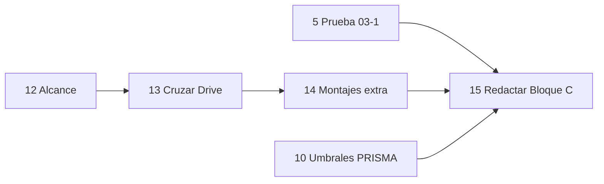

# Roadmap — lunes 2026-10-12 (8 h) — cerrado

**Objetivo del día:** un conteo de subidas y bajadas que funcione con la puerta
abierta, medido contra una verdad que incluya bajadas, y comparado con la línea
base sin tracking. Es la primera respuesta, en pequeño, a la pregunta de la tesis.

## Dónde quedó el domingo 11-10

- Golden de tracking `tm07_a` (100 frames, 10 personas) publicado contra los jobs
  #17–#28. Pasa a ser de **validación**: con él se eligieron tracker y ROI.
- Bloque C en `feature/flow-events`: `scripts/flow/events.py` (regla de cruce con
  dos curvas de puerta), `events_video.py` (videos de eventos) y
  `configs/cameras/videoTM_07.yaml`.
- Geometría probada: zona (cuenta a quien está de pie en la puerta), líneas de
  suelo (las cabezas las rodean), curvas de arriba abajo (bien puestas, pero el
  tracker casi nunca ve a la persona fuera: #28 cuenta 2 de 9 subidas).
- **Hallazgo:** el cuello de botella es que el detector no ve las cabezas en la
  puerta. No son los cambios de ID.
- Puerta abierta detectada por similitud de bordes con la puerta cerrada:
  `data/flow_videos/puerta_abierta_videoTM_07.json` (8 intervalos; 1.054–1.579 es
  falso, 5.347 y 15.940 dudosos). El 59 % de los eventos del #28 eran con la
  puerta cerrada.

## Cierre del día (lunes 12-10)

**Cumplido el objetivo:** hay conteo de subidas y bajadas con la puerta abierta,
medido contra un golden con bajadas y comparado con la línea base sin tracking.

| Bloque | Estado | Resultado |
|---|---|---|
| 1. Detección de puerta | ✅ | 7 de 8 intervalos bien; 1.054–1.579 falso (bus rojo visto por el vidrio), excluido. Además, versionado en `scripts/flow/door.py` (reproduce el JSON) |
| 2. Golden de eventos | ✅ | Anotado en CVAT (un job por apertura): **52 eventos, 23 subidas y 29 bajadas** en 7 aperturas. `data/flow_golden/videoTM_07.csv` (versionado) |
| 3. Regla origen–destino | ✅ | `events.py --rule od` (por defecto) con autoprueba. En tm07_a: 8 de 10 (antes 2-4) |
| 4. Línea base sin tracking | ✅ | `scripts/flow/baseline.py`: mismas detecciones, ROI y puerta; empareja frames consecutivos |
| 5. Evaluación de conteo | ✅ | `scripts/flow/eval_flow.py` — tabla abajo |
| 6. Videos y errores | ✅ | Videos con el golden en `data/flow_videos/paradas_od/`; causas automáticas con `error_causes.py` y **revisión a ojo de las 23 perdidas** (hojas de 5 frames con detecciones crudas y tracks): `data/flow_golden/errores_job27_revisados.csv` |
| 7. Cierre | ✅ | Commits 784a906…f147c27 pusheados; este roadmap |

**Corrección:** en tm07_a hay **10** subidas, no 9 (la regla de curvas no contaba
a quien nace ya en el umbral).

### Tabla I — videoTM_07, 7 aperturas

| Sistema | Subidas (de 23) | Error | Bajadas (de 29) | Error |
|---|---|---|---|---|
| **#27 ByteTrack + origen–destino** | **15** | **−35 %** | **17** | **−41 %** |
| #28 Deep OC-SORT + origen–destino | 14 | −39 % | 12 | −59 % |
| #27 + regla de curvas | 10 | −57 % | 9 | −69 % |
| Sin tracking (línea base) | 7 | −70 % | 11 | −62 % |

Precisión 1,00 en todos (emparejando a ±10 frames): ningún sistema inventa
eventos; todo el error es gente sin contar. Emparejando también por posición, el
#27 pierde 23 personas en vez de 20: 3 aciertos eran de otra persona.

**Lectura:** el tracking aporta (×2 subidas frente a sin tracking), la regla
origen–destino es la mayor mejora del día y ByteTrack supera a Deep OC-SORT. El
techo sigue siendo el detector.

### Por qué se pierde gente (#27, 23 personas)

| Causa | n | |
|---|---|---|
| nace-tarde | 9 | el track aparece ya en la puerta |
| corto | 5 | el track se rompe antes del pasillo / la puerta |
| intermitente | 3 | la cabeza se detecta 1-2 frames |
| detector | 2 | ninguna detección cerca |
| doble | 2 | un track para dos personas |
| tracker | 1 | detecciones suficientes sin track |
| tiempo | 1 | contada 18 frames tarde (persona lenta) |

61 % tracks partidos, 22 % detector puro, 9 % identidad. La parada 12613 (bus
lleno) es la peor: congestión alta.

### Decisiones y criterios fijados hoy
- **Criterio de anotación de eventos:** punto sobre la cabeza cuando **alcanza** la
  curva interior. Sesgo medido: 1-4 frames antes que el cruce del centro; constante,
  dentro de la tolerancia. Va a la guía de anotación.
- `raro` es para dudas de si cuenta o en qué dirección, no para defectos del video.
  **El video salta frames** (p. ej. 5.396→5.397): no se anota, se medirá aparte.
- **No adoptadas** (ajustadas con los mismos 52 eventos = fuga de evaluación):
  pasillo a 40 px (+3 bajadas) y combinar con cruce simple (+2/+4). Candidatas para
  validar con otras cámaras.
- **Las 7 aperturas de videoTM_07 son de evaluación:** no se entrena con ellas.

### Revisión a ojo de las 23 personas perdidas (#27)

Camilo revisó cada perdida en una hoja de 5 frames con las detecciones CRUDAS
(antes del tracker) y las cajas del tracker:

| Letra | Qué se ve | n | % |
|---|---|---|---|
| **S** | la cabeza tiene detección y no tiene ID (o el ID aparece y desaparece) | 10 | 43 % |
| **I** | el ID cambia o salta a otra persona | 6 | 26 % |
| **V** | la cabeza se ve y no hay detección | 5 | 22 % |
| **C** | detección e ID estables, la regla no cuenta (nace entre líneas y muere antes del pasillo) | 2 | 9 % |

Comprobado con datos: las detecciones junto a las personas S e I tienen
**confianza alta (0,7–0,9) y están todas dentro de la ROI**. No son detecciones
dudosas ni filtradas: el tracker no abre o no mantiene el track.

> **Corregido por la tarea 1 (tarde del 12-10):** el reparto real es ≈40 % tracker /
> ≈50 % detector. Ver `docs/diagnostico-bytetrack-puerta.md`.

~~**Conclusión: ~70 % de las pérdidas son del TRACKER (S + I), ~22 % del detector.**~~
Corrige la lectura de la mañana ("el techo es el detector"): eso valía para la
regla de curvas. La revisión automática (`nace-tarde`/`corto`) no lo separaba;
la revisión a ojo sí.

Siguiente pregunta: **por qué ByteTrack no confirma tracks con detecciones de
0,9**. Hipótesis por comprobar: (a) la detección se la queda otro track cercano
(`match_thresh 0,9` es permisivo y explica también los I); (b) los tracks nuevos
necesitan frames seguidos para activarse y en la puerta la cabeza parpadea; (c) el
dedup posterior. Se comprueba repitiendo ByteTrack sobre `dets.npy` en una parada.

## Tarea 1 hecha: diagnóstico de ByteTrack en la puerta (tarde del 12-10)

Detalle caso a caso en `docs/diagnostico-bytetrack-puerta.md`. El script
`scripts/flow/diag_bytetrack.py` repite el ByteTrack del #27 sobre `dets.npy` y lo
reproduce caja a caja. Las 16 perdidas S/I se reparten en tres causas:

| Causa | n | Qué pasa |
|---|---|---|
| A. Activación | 4 | un track nuevo se borra si en el frame siguiente no tiene una detección >= 0,25 que solape; sin margen |
| B. Huecos del detector | 7 | 8–25 frames sin ninguna detección cerca, o (en bajadas) la persona no se ve en el pasillo |
| C. Reenganche | 5 | tras un hueco, la recuperación solo por IoU crea un ID nuevo o se lleva a otra persona |

**Cambia la lectura de la mañana:** con las 5 V, el detector pesa ≈50 % y el tracker
≈40 %. Las "S" de la revisión eran en parte un efecto de las hojas: un frame de cada
6 enseña el nacimiento de un track, que ByteTrack nunca dibuja. No es el dedup ni la
ROI.

**Consecuencias para el plan:**
- El reentrenamiento **vuelve a prioridad alta**. Pero no puede usar las 7 aperturas
  de videoTM_07 (son de evaluación), así que depende por completo de `sda2`. Montar
  `sda2` pasa a ser el bloqueo principal: sin él no hay ni validación ni
  reentrenamiento.
- El ajuste del tracker se concreta en dos candidatos: activación más floja (A) y
  unir trozos de track después del tracker (C). `match_thresh` ya no es la palanca.
- Los saltos de video suben de prioridad. Pueden explicar reenganches lejanos (5401),
  y la unión de trozos necesita conocerlos para fijar el hueco máximo.
- Se confirma la B de las bajadas a ojo antes de apoyarse en ella: la evidencia es
  indirecta.

## Plan de la siguiente sesión (revisado, tarde del 12-10)

| # | Prioridad | Tarea | Quién | Depende de | Entregable | Tiempo |
|---|---|---|---|---|---|---|
| ~~1~~ | ✅ | ~~Diagnosticar ByteTrack en la puerta~~ | Claude | — | `docs/diagnostico-bytetrack-puerta.md` | hecho |
| ~~2~~ | ✅ | ~~Montar `sda2`~~: vaciado al NVMe (24 videos en `~/videos/`, CVAT viejo en `~/backups/cvat_viejo/`); el `sda` queda libre | Camilo | — | — | hecho |
| ~~1b~~ | ✅ | ~~Confirmar a ojo las B~~: **superada** por `error_causes.py`: la persona tiene track, pero el último trozo nace en la puerta (`nace-tarde`) | Camilo | 1 | — | cerrada |
| ~~8~~ | ✅ | ~~Medir los saltos de frames~~: 556 (32 en aperturas); junto a un salto los tracks se pierden ×4, pero es solo el 11–16 % de las pérdidas. Ver diagnóstico | Claude | — | `scripts/flow/frame_jumps.py` + `data/flow_eval/saltos_videoTM_07.csv` | hecho |
| ~~3a~~ | ✅ | ~~Candidato A, activación~~: **negativo**, ninguna de las 8 variantes mejora (ver diagnóstico) | Claude | 1 | `data/flow_eval/sweep3a/` | hecho |
| ~~3b~~ | ✅ | ~~Candidato C, unir trozos~~: **peor** (bajadas −52 %); la cercanía confunde la cola de gente → haría falta apariencia | Claude | 1, 8 | `scripts/flow/stitch.py` | hecho |
| ~~3c~~ | ✅ | ~~Interpolar frame congelado~~: **neutro** | Claude | 8 | `diag_bytetrack.py run --interp` | hecho |
| 3d | ⚪ Hecho, negativo | **Unir trozos por apariencia** (`reid_feats.py` OSNet/HSV + `stitch.py --feats`), barrido en el 03 y comprobado en el 07: ningún umbral mejora. La apariencia cenital no discrimina (OSNet 0,18–0,45 para todos) y los saltos en la puerta son de 80–200 px | Claude | 6 | Tabla I 03 y 07 | 12-10 |
| 9 | ⚪ Hecho, negativo | **Ronda 7 de puerta**: 235 frames minados (`mine_door.py`), corregidos en CVAT (tarea 5), `bus_head_v7` = v5_min5 + 188 imágenes, `yolo26x-v7` con la receta del campeón. **No mejora**: golden MAE 1,62 vs 1,68 (IC95 pareado [−0,26; 0,15], p = 0,73; video02 1,92 vs 1,89); Tabla I −39 %/−45 % vs −35 %/−41 %. Ver el diagnóstico | Los dos | — | `yolo26x-v7` + golden + Tabla I | 12-10 |
| ~~4~~ | ✅ | ~~Inventario por congestión~~: `docs/inventario-camaras.md`. Solo 4 diurnos nunca vistos: 02 alta, 03(1) media, 03 baja, 08 muy baja; 17 es nocturno; intel* es otra escena | Claude | 2 | `docs/inventario-camaras.md` | hecho |
| 5 | 🔴 En curso | **Goldens de PRUEBA.** **02 HECHO** (59 eventos): sin corregir −28 %/−39 %, corregido **+7 %/−1 %** (real dentro del IC95), precisión 0,85/0,92 (3 falsos de `door.py` por oclusión). **03(1)**: geometría HECHA (curvas parabólicas trazadas por Camilo + ROI = todo a la izquierda de su línea, `configs/cameras/videoTM_03_1.yaml`); falta elegir el golden (completo o reducido), anotar y evaluar una vez | Camilo (CVAT) + Claude | 6 | Tabla I de prueba | 2–4 h |
| 3e | ✅ Hecho | **Corrección de sesgo** (`calibrate.py`): factor = contado/real por dirección, bootstrap por aperturas. Ajustado solo en el 03 → 07 de −38/−38 a +3/+2 %. Factor final en 03+07: subidas 0,68 (0,47–0,94), bajadas 0,62 (0,52–0,73) | Claude | 6 | `configs/calibracion.yaml` | 12-10 |
| 6 | ✅ Hecho | **Golden de validación videoTM_03** (30 eventos) y **golden del 07 completado** (+6 aperturas cortas, 52 → 69 eventos). `door.py` corregido (`min_frames` 45 + guarda de túnel). Nueva línea base #27: 07 **−38 % / −38 %**, 03 bajadas **−39 %** (el −35/−41 era sobre un golden incompleto). Ver `docs/inventario-camaras.md` | Camilo (CVAT) | 2, 4 | goldens 03 y 07 | 12-10 |
| 7 | 🟡 Normal | **Guía de anotación** (la cabeza alcanza la curva interior, `raro`, saltos) + revisar con frames seguidos, no 1 de cada 6 | Claude | — | `docs/guia-anotacion.md` | 30 min |
| 10 | 🟢 Baja | **Confirmar la Fase 1 (PRISMA)**: umbrales de la Tabla I | Camilo | — | Umbrales de error aceptables | 15 min |
| 11 | 🟢 Baja | **Pendientes heredados**: NMS post-hoc en `serverless/yolo26x-head`, `eval_golden.py` a git, `AUTOINCREMENT` en track-studio, Caddyfile de `~/srv` | Claude (Caddyfile: Camilo) | — | Commits sueltos | 1 h |

## Estado al cierre del 12-10 (noche) y lo que falta

**Sistema congelado:** detector campeón + ROI + ByteTrack #27 + regla `od` +
`door.py` corregido + factor de `configs/calibracion.yaml`.

| Video | Uso | Eventos | Error sin corregir | Error corregido |
|---|---|---|---|---|
| 07 | desarrollo | 69 | −38 % / −38 % | +3 % / +2 % (factor solo del 03) |
| 03 | validación | 30 | bajadas −39 % | bajadas −1 % (en muestra) |
| 02 | **prueba** (congestión alta) | 59 | −28 % / −39 % | **+7 % / −1 %** |
| 03(1) | **prueba** (otro bus) | — | pendiente | pendiente |

| # | Prioridad | Falta | Quién | Depende de |
|---|---|---|---|---|
| 5 | 🔴 | **03(1)**: elegir el golden (completo, con el tramo lleno 23.150–27.000, ~4.700 imágenes, o reducido), anotar en CVAT y evaluar una vez | Camilo + Claude | — |
| 12 | 🔴 | **Decidir el alcance**: ¿solo cámaras de Bus? Station es otra escena (andén), así que sería trabajo futuro | Camilo | — |
| 15 | 🔴 | **Redactar el Bloque C en el artículo**: método, Tabla I de 07/03/02, corrección de sesgo, resultados negativos y limitaciones | Los dos | 5 |
| 13 | 🟠 | **Cruzar el Drive** (Bus/Station × 4 ángulos: DoubleDoorLeft/Right, SingleDoorMiddle, SingleDoorRear) con los 24 videos: cuántos montajes hay y cuántos goldens cuestan | Claude | 12 |
| 14 | 🟠 | Por cada montaje de bus extra: geometría (ROI + curvas + `door_open`, ~15 min de Camilo) y **un** golden de eventos de prueba. No hacen falta goldens de tracking (se mide conteo, no HOTA) | Los dos | 12, 13 |
| 10 | 🟠 | Umbrales de error aceptables (PRISMA): ¿el ±7 % cumple? | Camilo | — |
| 7 | 🟡 | Guía de anotación de eventos, escrita para la memoria | Claude | — |
| 11 | 🟢 | Pendientes heredados de track-studio | Claude | — |

**Por dónde seguir:** 5 (03(1)) y 12 (alcance), luego 15. Las 13 y 14 solo si el
alcance incluye más montajes de bus.

## Riesgos del día
- **La detección de puerta falla en paradas llenas** (la gente tapa la puerta):
  plan B, marcar los intervalos a mano. Son dos tiempos por parada.
- **La regla origen–destino sufre con la fragmentación:** un track que se rompe
  en el pasillo cambia su origen o su destino. Se mide con el golden de eventos,
  no se arregla hoy.
- **Pocas paradas en videoTM_07** (5–7 reales): sirve para validar la regla, no
  para conclusiones. Las conclusiones necesitan las otras cámaras.
